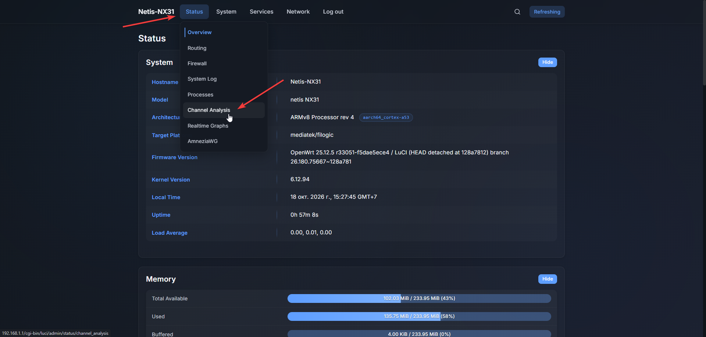
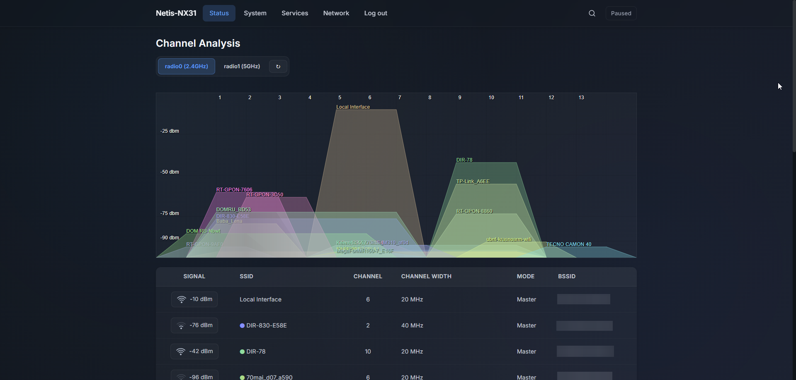
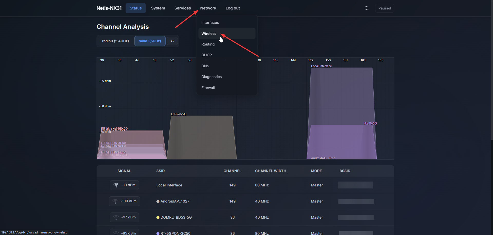
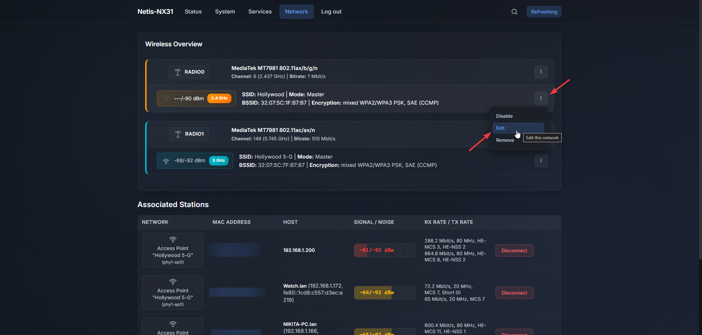
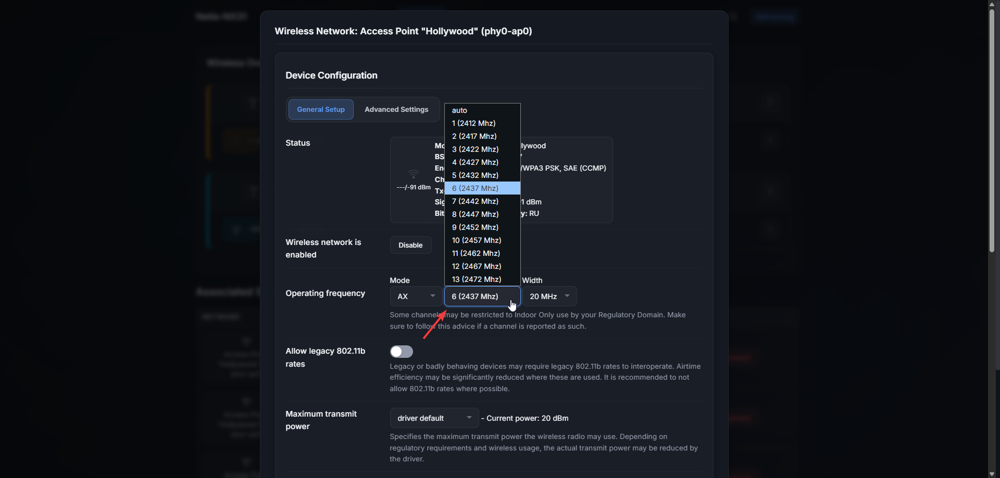

# Как выбрать канал для точки доступа Wi-Fi?

Правильный выбор Wi-Fi-канала помогает уменьшить помехи от соседних сетей, повысить стабильность соединения и избежать лишних задержек.

### Почему не стоит ставить режим "auto"?

Потому что в режиме auto роутеры заводят хоровод и начинают все вместе прыгать по незанятым каналам. То есть ваш роутер и роутеры соседей вещают на одном канале и понимают, что канал перегружен. Видят рядом свободный канал и все вместе переходят на него. Через время ситуация повторяет и снова все роутеры переходят на другой канал.

### Как посмотреть на каких каналах сидят другие роутеры и на какой стоит перейти?

1. Заходим в "Status" → "Channel Analysis":
   

2. После чего мы там видим 2 вкладки "radio0 (2.4GHz)" и "radio1 (5GHz)", а также ближайшие Wi-Fi точки доступа к нам. По этим данным мы можем узнать на каком канале находится каждая из точек доступа, а также какой уровень шума/сигнала от неё идёт.
   

   С помощью этих данных мы сможем понять какой канал самый свободный, чтобы выбрать его для нашей точки доступа:
   - для Wi-Fi 2.4GHz лучше выбирать каналы: 1, 6 или 11;
   - для Wi-Fi 5GHz лучше выбирать каналы: 36-48, 50-144¹, 149-161.

3. После выбора канала заходим в "Network" → "Wireless":
   

4. Выбираем нужный нам интерфейс и нажимаем "Edit":
   

5. В настройках интерфейса выбираем нужный нам канал.
   

### Сноска:

1 – каналы 50-144 лучше не использовать, потому что это DFS-каналы. То есть каналы с динамическим выбором частоты, которые используются погодными радарами и военными службами. Если роутер обнаружит рядом такой радар, то он обязан выключить вещание или сменить канал, что может вызвать обрыв связи.